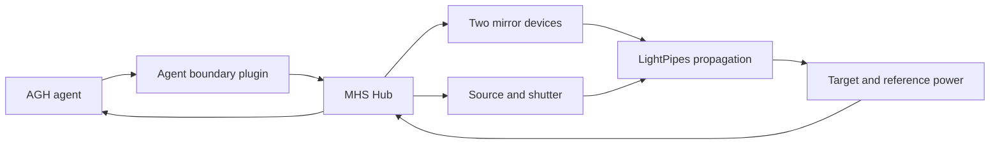

# BeamLab

English | [简体中文](README.zh-CN.md)

A simulated optical bench for agent-guided, two-mirror beam alignment: adjust the mirrors, measure optical power, and refine the alignment using feedback.

## Overview · from alignment to feedback

Aligning a beam is a coupled control problem: moving one mirror changes what reaches the target and can affect how useful the next measurement is. BeamLab combines a physical propagation model with instrument-like interfaces so the control process can be explored as a sequence of observations and adjustments.

The bench includes a source and shutter, two independently controlled mirrors, a target power meter, a reference meter and an environment device. LightPipes models optical propagation; a project-specific agent boundary plugin and MHS devices connect the bench to an externally installed Agnes Harness (AGH).

**What is included:** the numerical bench and scenarios, instrument adapters, an alignment example, workbench integration and tests. Device simulation and the alignment workflow are project contributions; MHS and AGH are external infrastructure.

## Demo · see the bench respond

[](lab-notes/media/beam-alignment.mp4)

[Full demonstration](lab-notes/media/beam-alignment.mp4) · [Experiment page](lab-notes/experiment.html) · [Bench image](lab-notes/media/bench.jpg)

The video follows mirror adjustment and power feedback during alignment.

## Architecture · instruments and control



| Layer | Main files | Function |
| --- | --- | --- |
| Optical model | [physics.py](src/beamlab/physics.py), [world.py](src/beamlab/world.py) | Propagation and simulated bench state |
| Device integration | [devices.py](src/beamlab/devices.py), [hubclient.py](src/beamlab/hubclient.py) | Instrument operations and Hub communication |
| Control | [optimizer.py](src/beamlab/optimizer.py), [two_mirror_alignment.py](experiments/two_mirror_alignment.py) | Alignment logic and example |
| Agent boundary | [plugins/guard](plugins/guard) | Project-specific agent integration |

Scenarios are defined in [experiments/scenarios.json](experiments/scenarios.json); the instruments are described in [lab notes](lab-notes/instruments.md).

## Integration · setup and interfaces

### Instrument contract

Mirrors expose two angular axes in degrees; power meters report watts and environmental temperature is expressed in degrees Celsius. Devices connect to the MHS Hub through JSON-RPC over WebSocket, using `hub/hello`, `hub/read` and `hub/call`. The project plugin is `@beamlab/agent-boundary`. Refer to [devices.py](src/beamlab/devices.py) and [hubclient.py](src/beamlab/hubclient.py) for the operation and message definitions.

### Run an alignment

On Linux with Python 3.13 and Node.js 24, install AGH separately first. The setup uses its MHS Python SDK:

```bash
export AGH_SOURCE_DIR=/opt/agnes-harness
make setup
make align
```

For the AGH-controlled workflow, build the external runtime, attach the instruments and configure the model:

```bash
source .venv/bin/activate
(cd "$AGH_SOURCE_DIR" && pnpm install --frozen-lockfile && pnpm --filter @agnes/cli build:local && pnpm --filter @agnes/mhs build:plugin)
python scripts/attach_instruments.py
cp .env.example .env
# Set MODEL_BASE_URL and DEEPSEEK_API_KEY in .env
set -a; source .env; set +a
python scripts/start.py start --base-port 44640 --instance lab
python scripts/run_instance.py --instance lab --prefix alignment_001 --case geometric --policy mimo
python scripts/start.py stop --base-port 44640 --instance lab
```

With that base port the workbench is at `http://127.0.0.1:44644/`. See [bring-up](lab-notes/bring-up.md) for setup and service lifecycle. Core checks: `PYTHONPATH=src python -m pytest tests/test_physics.py tests/test_optimizer.py -q`. Third-party notices: [licenses/README.md](licenses/README.md).
