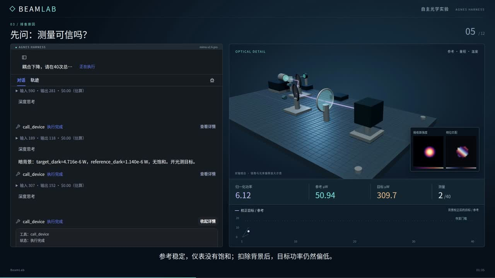

# BeamLab｜双镜光路实验台

用测量反馈完成光路诊断、校准与对准。

[](lab-notes/media/beam-alignment.mp4)

[查看实验演示](lab-notes/media/beam-alignment.mp4)　[打开播放器](lab-notes/experiment.html)

---

## 台面说明

光路的目标是让光束经过两面反射镜后进入接收区域。镜面角度、光源状态、仪表暗偏置、量程和温度变化都会影响读数。只看到目标功率下降，往往无法直接知道应该调镜、校准仪表还是处理环境状态。

BeamLab 把这个过程做成一个可交互的数值实验台：LightPipes 传播光场，设备程序提供镜台、功率计和环境装置，AGH 根据标量测量结果安排实验、执行对准和复测。MHS 负责把这些仪器接入智能体。

```text
                        ┌────────────── 参考支路 ── 参考功率计
光源 / 快门 ── 分光 ────┤
                        └── 反射镜 1 ── 反射镜 2 ── 目标功率计
                                      ↑
                              镜角、温度与测量反馈
```

参考支路位于镜台上游，便于对照光源变化；目标支路反映经过光路后的接收结果。光路对准以背景校正后的目标与参考关系作为反馈。

### 仪器清单

| 装置 | 数量 | 主要操作或读数 |
|---|---:|---|
| 光源与快门 | 1 | 开关、光源设定、暗测条件 |
| 双轴反射镜 | 2 | 角度设定、编码器、运动状态 |
| 目标功率计 | 1 | 目标支路功率、量程与采样计数 |
| 参考探测器 | 1 | 参考支路读数 |
| 环境装置 | 1 | 温度、环境状态与联锁 |

共六个 MHS 设备。镜角使用度，功率使用瓦，温度使用摄氏度。

## 这项工作包含哪些工程环节

**一、数值光学。** 光场由 LightPipes 进行近轴传播计算，反射镜角度改变光束方向，接收端得到耦合与功率结果。

**二、仪器行为。** 仪表包含暗背景、量程、饱和和噪声等状态，运动与采样通过设备接口协调。光学结果、仪器读数和控制设置共同形成实验反馈。

**三、局部寻优。** `optimizer.py` 通过“移动镜台”和“读取功率”的回调进行有限次测量寻优，作为智能体可以使用的专业数值能力。

**四、智能实验组织。** AGH 可以先检查参考与暗背景，再选择镜台实验、环境处理、局部拟合和最终验证。领域接入把这些操作组织为同一实验任务。

**五、可观察的实例。** 启动器建立独立工作区、端口和服务配置，浏览器工作台显示该实例的当前实验。

AGH 和 MHS 提供智能体与设备接入基础；本项目实现光学装置、仪器模型、诊断操作、数值寻优和完整实验流程。

## 实验一：两面镜子的自动对准

准备 Linux、Python 3.13 和 Node.js 24。数值光场由 CPU 计算。

```bash
export AGH_SOURCE_DIR=/opt/agnes-harness
make setup
make align
```

`AGH_SOURCE_DIR` 指向仓库外的 AGH 工作区，其中 MHS Python SDK 为仪器对象提供接口。`make setup` 建立环境并安装科学依赖与这份外部 SDK；`make align` 执行 `experiments/two_mirror_alignment.py`。

实验会设置一组镜面偏移，采集功率反馈，使用局部优化算法调整镜角，打印三项结果：

- 对准前的耦合率。
- 对准后的耦合率。
- 使用的测量次数。

这里把光学模型、仪器运动与寻优算法连在一起，适合作为修改数值模块后的第一个检查入口。

## 实验二：让智能体组织一次诊断

智能实验使用仓库外的 AGH 与 MHS 安装。激活 Python 环境后连接：

```bash
source .venv/bin/activate
export AGH_SOURCE_DIR=/opt/agnes-harness
(cd "$AGH_SOURCE_DIR" && pnpm install --frozen-lockfile && pnpm --filter @agnes/cli build:local && pnpm --filter @agnes/mhs build:plugin)
python scripts/attach_instruments.py
```

本地连接、SDK 构建和实例状态都写入已忽略的运行目录。`--check` 可先核对依赖，不启动实验。

先复制模型服务配置：

```bash
cp .env.example .env
```

填写 `MODEL_BASE_URL` 与凭据。启动器沿用 `DEEPSEEK_API_KEY` 这个环境变量名，模型配置请求 `mimo-v2.6-pro`。

```bash
source .venv/bin/activate
set -a; source .env; set +a
python scripts/start.py start --base-port 44640 --instance lab
python scripts/run_instance.py \
  --instance lab \
  --prefix alignment_001 \
  --case geometric \
  --policy mimo
```

浏览器工作台位于 **http://127.0.0.1:44644/**。启动器为实例保存端口与工作区配置，`run_instance.py` 读取这份配置后启动实验。`--prefix` 用于区分新任务。

实验结束后关闭实例：

```bash
python scripts/start.py stop --base-port 44640 --instance lab
```

模型、端口和实例的详细准备步骤见[实验台启用笔记](lab-notes/bring-up.md)。

## 阅读实验程序

如果从光学原理入手，先阅读 `src/beamlab/physics.py`，然后看 `world.py` 如何把光场与装置状态组合起来。

如果从自动对准入手，先运行 `experiments/two_mirror_alignment.py`，再阅读 `optimizer.py` 的测量回调和采样预算。

如果从智能体接入入手，阅读 `plugins/`、`hubclient.py`、`lab.py`，以及 `scripts/start.py` 与 `run_instance.py`。

示例场景位于 `experiments/scenarios.json`，任务与接入设置位于 `protocol/`；仪器说明见 [lab-notes/instruments.md](lab-notes/instruments.md)。

## 检查记录应该关注什么

功率下降本身只是一个现象。检查一次实验时，应把参考读数、暗背景、目标读数、镜角、量程和环境状态放在一起看。对准后还需要进行新的采样，确认改变的镜角确实改善了接收结果。

修改光学计算或优化器后，可运行：

```bash
source .venv/bin/activate
pip install -r requirements-dev.txt
PYTHONPATH=src python -m pytest \
  tests/test_physics.py tests/test_optimizer.py -q
```

---


[组件和软件来源](licenses/README.md)　[项目许可证](LICENSE)
