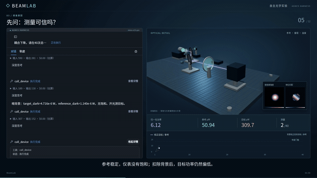
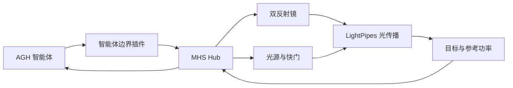

# BeamLab 光路自动对准

[English](README.md) | 简体中文

在仿真光学实验台上调整双反射镜、读取功率反馈，让智能体逐步完成光束对准。

## 项目介绍 · 从调整到反馈

双镜对准是相互耦合的控制问题：调整一面镜子会改变到达目标的光束，也会影响下一次测量。BeamLab 将光传播模型与仪器接口结合，把对准过程组织为连续的观察、调整和反馈。

实验台包含光源及快门、两面可控制反射镜、目标功率计、参考功率计和环境设备。项目用 LightPipes 计算光传播，并通过项目插件与 MHS 设备连接单独安装的 Agnes Harness（AGH）。

仓库包含数值光路、场景、仪器适配、对准示例、工作台集成和测试。设备仿真与对准流程由项目实现，MHS 和 AGH 为外部基础设施。

## 演示视频 · 观察实验台响应

[](lab-notes/media/beam-alignment.mp4)

[观看完整演示](lab-notes/media/beam-alignment.mp4) · [实验展示页](lab-notes/experiment.html) · [实验台图像](lab-notes/media/bench.jpg)

视频展示了调整反射镜与读取功率反馈的过程。

## 技术架构 · 仪器与控制



| 层次 | 主要文件 | 作用 |
| --- | --- | --- |
| 光学模型 | [physics.py](src/beamlab/physics.py)、[world.py](src/beamlab/world.py) | 光传播与实验台状态 |
| 设备接入 | [devices.py](src/beamlab/devices.py)、[hubclient.py](src/beamlab/hubclient.py) | 仪器操作与 Hub 通信 |
| 控制 | [optimizer.py](src/beamlab/optimizer.py)、[对准示例](experiments/two_mirror_alignment.py) | 对准逻辑与示例 |
| 智能体边界 | [plugins/guard](plugins/guard) | 项目专用智能体集成 |

场景定义见 [experiments/scenarios.json](experiments/scenarios.json)，设备说明见 [仪器笔记](lab-notes/instruments.md)。

## 集成标准 · 配置与接口

### 仪器接口

反射镜包含两个角度轴，单位为度；功率计以瓦为单位，环境温度以摄氏度表示。设备通过 WebSocket 上的 JSON-RPC 接入 MHS Hub，使用 `hub/hello`、`hub/read` 和 `hub/call`。项目插件为 `@beamlab/agent-boundary`；操作与消息定义见 [devices.py](src/beamlab/devices.py) 和 [hubclient.py](src/beamlab/hubclient.py)。

### 运行对准

Linux、Python 3.13 和 Node.js 24 环境下，先单独安装 AGH；项目安装过程需要其 MHS Python SDK：

```bash
export AGH_SOURCE_DIR=/opt/agnes-harness
make setup
make align
```

连接 AGH 智能体时，构建外部运行时、接入仪器并配置模型：

```bash
source .venv/bin/activate
(cd "$AGH_SOURCE_DIR" && pnpm install --frozen-lockfile && pnpm --filter @agnes/cli build:local && pnpm --filter @agnes/mhs build:plugin)
python scripts/attach_instruments.py
cp .env.example .env
# 在 .env 中设置 MODEL_BASE_URL 和 DEEPSEEK_API_KEY
set -a; source .env; set +a
python scripts/start.py start --base-port 44640 --instance lab
python scripts/run_instance.py --instance lab --prefix alignment_001 --case geometric --policy mimo
python scripts/start.py stop --base-port 44640 --instance lab
```

使用上述基础端口时，工作台地址为 `http://127.0.0.1:44644/`。配置及服务启停见 [启动说明](lab-notes/bring-up.md)。核心测试：`PYTHONPATH=src python -m pytest tests/test_physics.py tests/test_optimizer.py -q`。第三方许可见 [licenses/README.md](licenses/README.md)。
